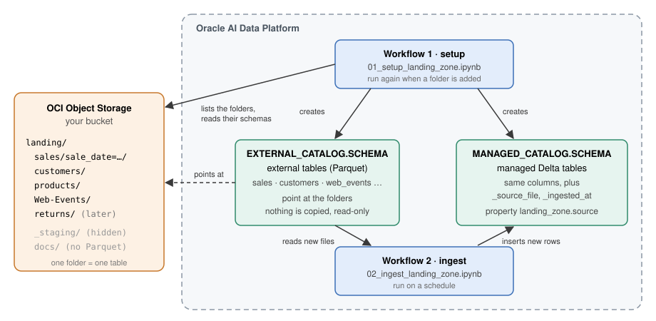
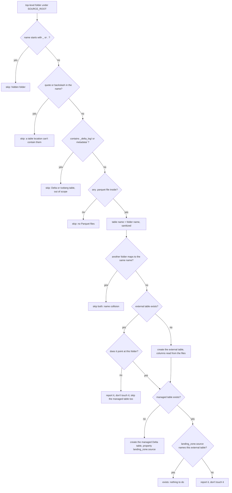

# Landing Zone Auto-Ingestion (Parquet)

Drop Parquet files into folders in an OCI Object Storage bucket, and two workflows keep a set of
**managed Delta tables** in AI Data Platform (AIDP) up to date: one table per folder, created
automatically, loaded incrementally, with no table list to maintain.



## The folder convention

Under a source location, `oci://<bucket>@<namespace>/<prefix>/`, **each top-level folder is one table**.
A folder may contain `column=value/` subfolders, which become partition columns.

```
oci://<bucket>@<namespace>/landing/        <- SOURCE_ROOT
  sales/
    sale_date=2026-10-18/part-00000.parquet  -> table sales, partitioned by sale_date
    sale_date=2026-10-19/part-00000.parquet
  customers/part-00000.parquet             -> table customers
  Web-Events/part-00000.parquet            -> table web_events (name sanitized)
  _staging/                                -> skipped: hidden folder
  docs/notes.txt                           -> skipped: no Parquet files
```

## What the two workflows do

**Workflow 1, setup** (`01_setup_landing_zone.ipynb`) creates two tables per folder:

- an **external table** in `EXTERNAL_CATALOG`, pointing at the folder. Nothing is copied, and
  dropping it later leaves the files alone. Its columns are read from the Parquet files.
- a **managed Delta table** in `MANAGED_CATALOG`, with the same columns plus `_source_file` and
  `_ingested_at`. Its table property `landing_zone.source` names the external table it is loaded from.

It is safe to rerun: run it again whenever a new folder appears, and only the new folder gets tables.
It never creates catalogs, and never changes or drops a table it did not create. The decision it
makes for each folder:



Table names are the folder name in lowercase, with any character other than a letter, digit or `_`
replaced by `_`, and a `t_` prefix when it starts with a digit: `Web-Events` becomes `web_events`.

**Workflow 2, ingest** (`02_ingest_landing_zone.ipynb`) loads new data into every managed table that
carries the `landing_zone.source` property, so a folder added later is picked up as soon as workflow 1
has created its tables. For each table it:

1. runs `REFRESH TABLE` on the external table, so files that landed since the last run are visible;
2. reads the external table with `input_file_name()` as `_source_file`, keeps only rows whose file is
   not in the managed table yet (a `LEFT ANTI JOIN`), and inserts them with the current time as
   `_ingested_at` - so a rerun never inserts anything twice;
3. compares row counts: fewer managed rows than external rows fails the table; more managed rows is
   only reported, because it means files were removed from the bucket after they were loaded.

Tables are processed **one after another**; within each table, Spark reads and writes the files in
parallel across the compute's executors, so a run takes roughly the sum of the per-table times. One
table failing doesn't stop the others; the run fails at the end if any table failed.

## When this pattern fits

Use it when files land in folders on a schedule and you want each folder to become a table without
maintaining a list of tables:

- **New folders become tables on the next setup run.** Adding a source is a matter of dropping its
  folder into the landing zone.
- **The raw files stay queryable in place** through the external tables, next to the managed Delta copies.
- **All the state lives in the tables.** The catalog records which folders are tables, and each managed
  table records which files it already holds (`_source_file`). There are no checkpoints or control
  tables to look after, and any run can be repeated safely.

The trade-off is that each ingest run reads every external table to find the new files, so its cost
grows with the landing zone rather than with the new data.

When you need lower latency, or the landing zone is large, a **streaming task** is the other pattern to
consider. A workflow notebook task with *Streaming* selected keeps running until it is stopped, using
Spark Structured Streaming: each stream reads only the files it has not seen and keeps its progress in a
checkpoint. Streaming file sources are read from volume paths, so you would read the bucket through an
external volume, and you would run one stream, with its own checkpoint, per table. See
[Streaming](https://docs.oracle.com/en/cloud/paas/ai-data-platform/aidug/streaming.html) in the AIDP documentation.

## What's in this folder

| File | Runs on | Purpose |
|---|---|---|
| `01_setup_landing_zone.ipynb` | AIDP, as a workflow | Workflow 1: creates the external and managed table of each folder. |
| `02_ingest_landing_zone.ipynb` | AIDP, as a workflow | Workflow 2: copies the rows of new files into the managed tables. |
| `generate_landing_zone.py` | your machine | Writes a small sample landing zone, and later a new day of sales or a new table folder. |
| `upload_to_bucket.sh` | your machine | Uploads a local folder to your bucket under a prefix, never overwriting files. |
| `architecture.svg` | - | The drawing above. |

## Prerequisites

- An AIDP workspace with a running compute.
- **Both catalogs exist**: the sample creates the schema inside them, never the catalogs. The defaults
  are `default` for the external tables and `silver` for the managed ones. They must be different
  catalogs, since the two tables of a folder have the same name.
- **The identity that runs the workflows can read the bucket.** A workflow runs as the user who
  created it unless you set another identity; that identity needs read access to the bucket, for
  example (adapted to your tenancy):
  ```
  allow group <group> to read buckets in compartment <compartment>
  allow group <group> to read objects in compartment <compartment> where target.bucket.name = '<bucket>'
  ```
- For the sample data: the OCI CLI with a configured `~/.oci/config`, and Python 3.

## Steps

**1. Put a landing zone in your bucket.** With the sample data (or use your own folders):

```bash
pip install -r requirements.txt
python generate_landing_zone.py initial landing
BUCKET=my-landing-bucket PREFIX=landing ./upload_to_bucket.sh landing
```

The script prints the `SOURCE_ROOT` to use, `oci://my-landing-bucket@<namespace>/landing/`. The prefix
is required: the workflows list the folders under it, and the bucket root itself cannot be listed.

**2. Import the notebooks** into your workspace.

**3. Create two workflows** in Workflows, each with one notebook task on your compute:

- `landing_zone_setup` → `01_setup_landing_zone.ipynb`, with job parameters `SOURCE_ROOT`,
  `EXTERNAL_CATALOG`, `MANAGED_CATALOG`, `SCHEMA`;
- `landing_zone_ingest` → `02_ingest_landing_zone.ipynb`, with job parameters `MANAGED_CATALOG` and
  `SCHEMA`. Set **max concurrent runs to 1**, so two runs never insert the same new files.

Job parameters override the defaults in the notebooks' first code cell, so you can also edit those.

**4. Run setup, then ingest.** Setup prints one line per folder (`created`, `exists`, or `skipped` with
the reason), and ingest prints the rows inserted per table. Put ingest on a schedule.

**5. Watch it behave incrementally:**

```bash
python generate_landing_zone.py new-day landing --day 2026-10-21    # a new day in an existing folder
python generate_landing_zone.py new-folder landing                  # a new folder: returns/
BUCKET=my-landing-bucket PREFIX=landing ./upload_to_bucket.sh landing
```

Run ingest: only `sales` grows, and `returns` is ignored, because it has no tables yet. Run setup: only
`returns` is created. Run ingest: `returns` is loaded and nothing else changes.

## Parameters

| Workflow | Parameter | Default | Meaning |
|---|---|---|---|
| setup | `SOURCE_ROOT` | `oci://<bucket>@<namespace>/landing/` | the folder whose subfolders are tables; must include a prefix |
| setup | `EXTERNAL_CATALOG` | `default` | catalog for the external tables |
| setup | `MANAGED_CATALOG` | `silver` | catalog for the managed Delta tables |
| setup | `SCHEMA` | `landing_zone_demo` | schema created in both catalogs |
| ingest | `MANAGED_CATALOG` | `silver` | where setup created the managed tables |
| ingest | `SCHEMA` | `""` | one schema, or empty for every schema in the catalog |

## What a run looks like

From the live test (the first setup run):

```
4 table folder(s), 2 skipped
+----------+------------------------------------+--------------------------+-----------------------------------+-------+
|folder    |external_table                      |external                  |managed_table                      |managed|
+----------+------------------------------------+--------------------------+-----------------------------------+-------+
|Web-Events|default.landing_zone_demo.web_events|created                   |silver.landing_zone_demo.web_events|created|
|customers |default.landing_zone_demo.customers |created                   |silver.landing_zone_demo.customers |created|
|products  |default.landing_zone_demo.products  |created                   |silver.landing_zone_demo.products  |created|
|sales     |default.landing_zone_demo.sales     |created                   |silver.landing_zone_demo.sales     |created|
|_staging  |-                                   |skipped: hidden folder    |-                                  |-      |
|docs      |-                                   |skipped: no .parquet files|-                                  |-      |
+----------+------------------------------------+--------------------------+-----------------------------------+-------+
```

And an ingest run after a new day of sales landed:

```
+-----------------------------------+------+---------+-------------+------------+-------------+----+
|table                              |status|new_files|rows_inserted|managed_rows|external_rows|note|
+-----------------------------------+------+---------+-------------+------------+-------------+----+
|silver.landing_zone_demo.web_events|ok    |0        |0            |300         |300          |    |
|silver.landing_zone_demo.products  |ok    |0        |0            |20          |20           |    |
|silver.landing_zone_demo.sales     |ok    |2        |200          |800         |800          |    |
|silver.landing_zone_demo.customers |ok    |0        |0            |50          |50           |    |
+-----------------------------------+------+---------+-------------+------------+-------------+----+
```

## Limitations

- **Tables are ingested sequentially.** With many tables, the run time adds up; processing tables
  concurrently (for example with a thread pool) is a possible extension, kept out to stay simple.
- **Each ingest run scans every external table** to find the new files, so its cost grows with the
  size of the landing zone, not with the size of the new data.
- **A file rewritten under the same name is not reloaded**: files are tracked by path. Land changed
  data as a new file.
- **Schema drift is not applied automatically.** The columns are fixed when setup creates the tables;
  new columns in later files are not added to either table.
- **Removed files**: their rows stay in the managed table, and ingest reports the difference. A folder
  whose files are *all* removed disappears from Object Storage (folders are only name prefixes), and
  ingest reports that table as failed with `PATH_NOT_FOUND`.
- **Parquet only.** Folders holding Delta or Iceberg tables are skipped.
- **Folder names with a quote (`'`) or a backslash are skipped**, since a table location can't contain
  them. Rename such folders without those characters to include them.

## Design notes

Choices in the notebooks that are worth knowing if you adapt them (verified on AIDP, Spark 3.5.0):

- **External tables are created with an explicit column list**, read from the Parquet files. A
  `CREATE TABLE ... USING PARQUET LOCATION '...'` without columns registers a table with no columns.
- **`REFRESH TABLE` is all a new partition needs.** Partitions are read from the `column=value/`
  folders, so new files and new partition folders appear after a refresh, with no repair step.
- **Each external table owns its folder.** A folder can back one external table; dropping an external
  table leaves the files in place.
- **Tables are created only after checking they don't exist** (`spark.catalog.tableExists`), with
  explicit columns, rather than with `CREATE TABLE IF NOT EXISTS ... AS SELECT`.
- **Rows are cast to the managed table's types on insert**, because Delta keeps column types strict:
  an `INT` value into a `BIGINT` column is rejected with `DELTA_FAILED_TO_MERGE_FIELDS`.
- **The external tables are read-only views of the files**; all changes happen in the managed tables.
- **Timestamps are written with a timezone (UTC)** by the generator, so Spark reads them as
  `TIMESTAMP` rather than `TIMESTAMP_NTZ`.

## Tested

October 2026, on AIDP (Spark 3.5.0): both notebooks run as workflows exactly as they are in this
folder, with the sample data in a bucket outside AIDP.

| Step | Bucket | Result |
|---|---|---|
| setup | initial landing zone | 4 tables created (`web_events` sanitized); `_staging` and `docs` skipped |
| ingest | - | all rows loaded: sales 600, web_events 300, customers 50, products 20; managed = external everywhere |
| ingest | + a sales day, + `returns/` | only sales grew (2 files, 200 rows, 800 = 800); `returns` ignored |
| setup | - | only `returns` created; every other table `exists` |
| ingest (every schema) | - | `returns` loaded (30 rows); nothing else changed |
| setup | - | nothing created |

The protective paths were exercised as well:

- **Left alone and reported:** an external table pointing at another folder, a managed table without
  the `landing_zone.source` property, and a managed table whose property names a different table.
- **Skipped:** a Delta folder; two folders mapping to the same name (`Orders`, `orders`); a folder name
  with a quote; a folder holding only hidden files.
- **Hidden files ignored:** a stray `_temporary/` Parquet file was not loaded and did not change the
  detected partitions.
- **Failures contained:** a missing catalog stopped setup with a clear message; in ingest, a dropped
  external table and an emptied folder failed their own tables while the others loaded, and the run
  failed at the end.
- **Reported, not failed:** a file removed from the bucket. A file re-uploaded under the same name was
  not reloaded.

## Clean up

In the catalog explorer, delete the tables of `landing_zone_demo` in both catalogs, then the two
schemas. Deleting a managed table deletes its data; deleting an external table leaves the files in the
bucket alone. Then delete the two workflows and the notebooks, and the landing-zone files if they were
only for testing.
